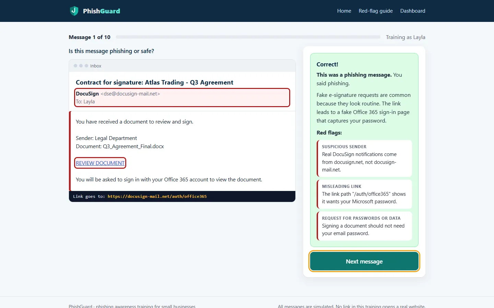
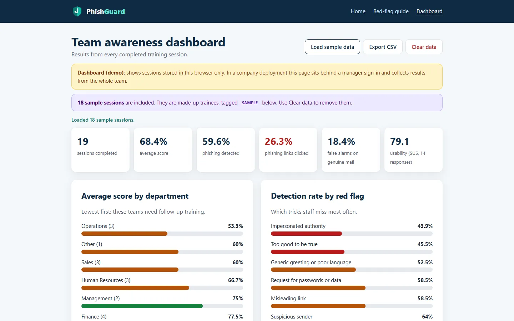

# PhishGuard

Phishing-awareness training for small businesses. Staff work through ten realistic emails and text messages, decide which ones are phishing, and see the red flags pointed out in the message itself.

**Try it:** https://israairtirt.github.io/phishguard/

| | |
|---|---|
| Type | Product |
| Original version | Node.js, Express, SQLite |
| Live demo | Runs entirely in the browser; data stays on the visitor's device |
| Security | Strict Content Security Policy, all data rendered as text; the server version adds scrypt password hashing, prepared statements and rate-limited sign-in |

## How it works

- Each session mixes six phishing messages with four genuine ones, drawn from sixteen emails and texts written for a fictional Libyan company. Genuine messages are there so people learn not to distrust everything.
- Messages are graded by how hard they are to spot, and every one carries at least two cues from eight red-flag types: a look-alike sender, a link that goes somewhere other than it says, urgency, a request for passwords or payment, and so on.
- After each answer the app highlights the cues on the message and explains them. A link inspector shows where a link really goes, the way hovering does on a desktop.
- The results page gives a score and a level, and offers a short System Usability Scale survey.
- The team dashboard shows average scores by department, which red flags staff miss most, survey results, and progress between a person's first and latest attempt. CSV export is guarded against spreadsheet formula injection.

## About the live demo

The original app keeps the answer key on the server and marks every answer there. The demo on GitHub Pages has no server, so the same marking logic runs in the browser and the dashboard reads only the sessions saved in your own browser. "Load sample data" fills it with clearly marked example sessions.

## About this repository

This repository holds the published build that GitHub Pages serves: minified HTML and CSS, and minified, obfuscated JavaScript. The source code is private.

Designed and built by [Israa Tarbaghia](https://israairtirt.github.io/).
